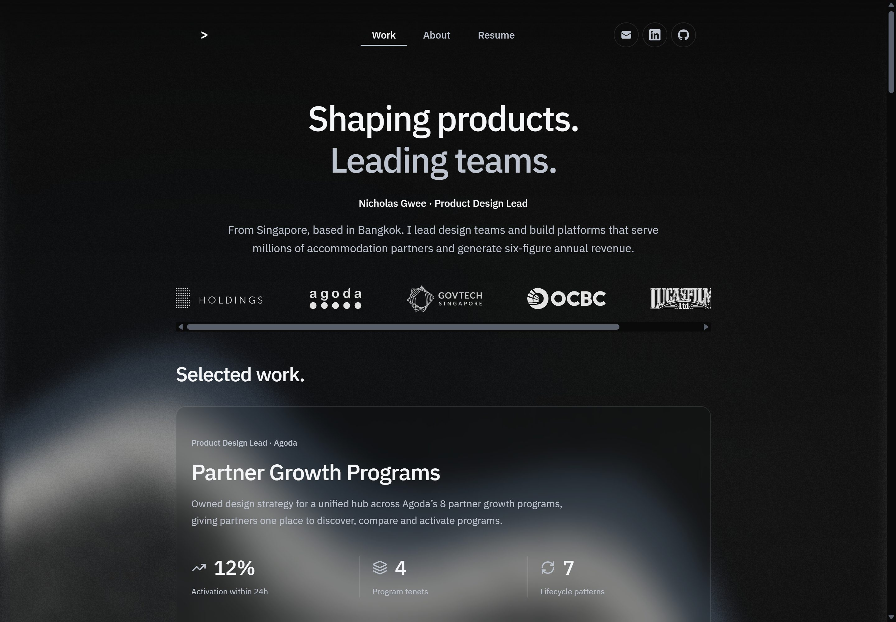

# Nicholas Gwee — Product Design Portfolio

Product design leadership, platform strategy, and hands-on interface design across Agoda, GovTech, banking, and visual effects.

[View the portfolio](https://nicgpk.github.io/portfolio/) · [Download résumé](files/NicholasGwee_Resume.pdf) · [ATS-friendly résumé](files/ats-resume.html)



## Selected work

- **[Partner Growth Programs](partner-growth-programs.html)** — A unified partner hub for discovering, comparing, and activating Agoda’s growth programs.
- **[Discounting 2.0](discounting.html)** — Clearer promotion setup, stacked-discount rules, and an interactive net-rate simulator.
- **[Developer Portal & Deployment](dev-portal.html)** — Service creation and private-cloud deployment, with an interactive deployment topology.

The homepage brings these case studies together with career experience, working principles, earlier GovTech projects, and a film-poster reel from my visual-effects work.

## Built for the browser

The site uses **static HTML, CSS, and vanilla JavaScript modules**, with locally hosted fonts, icons, and libraries. No framework, dependency installation, or build step is required to serve the checked-in site.

- **Focused layout:** an 860px homepage frame, project summaries and metrics above the interactive demos, and consistent case-study typography.
- **Interactive examples:** program comparisons, sequential discount calculations with cent rounding, and a deployment walkthrough. Demo data is illustrative; controls do not enroll properties or deploy infrastructure.
- **Responsive motion:** a pinned project showcase on sufficiently large screens, with a natural reading flow on compact screens or when reduced motion is requested.
- **Progressive enhancement:** the main content remains readable without JavaScript. The WebGL wave has static image/CSS fallbacks.
- **Rendering performance:** supported browsers render the wave in an OffscreenCanvas worker, cache static noise, and pause work when hidden, offscreen, or reduced motion is enabled. Main-thread and static fallbacks cover unsupported environments.
- **Keyboard support:** visible focus states, keyboard-operable demos, and mobile navigation with focus restoration and Escape handling.

## Run locally

Serve the repository with any static HTTP server. For example, with Python 3:

```sh
python -m http.server 4183
```

Open [localhost:4183](http://localhost:4183). Use an HTTP server rather than opening HTML files directly, so JavaScript modules and workers load correctly.

## Edit and verify

Use **Node.js 22 or newer** for the maintenance scripts and tests. There are no npm dependencies to install.

```sh
# Rebuild checked-in CSS bundles and refresh shared asset versions.
npm run build:css

# Verify generated files without changing them.
npm run check:css

# Check bundle freshness and run the test suite.
npm test
```

Edit the source stylesheets in `css/`; the build script generates `bundle-*.css` files and updates versioned asset URLs in the main pages. Rebuild after changing CSS or shared background/demo modules, then commit the generated files alongside their sources.

Tests cover demo calculations and validation, interaction interruption, reduced motion, project-scroll transitions, renderer fallbacks, worker scheduling, and graphics-resource cleanup. Browser and device checks complement these tests; they are not a complete accessibility or physical-device certification.

## Repository guide

```text
index.html                      Homepage and interactive project showcase
partner-growth-programs.html    Partner Growth Programs case study
discounting.html                Discounting 2.0 case study
dev-portal.html                 Developer Portal case study
resume.html                     Browser-friendly résumé
css/                            Source styles and generated bundles
js/                             Interactions, animation, and rendering modules
images/                         Portfolio imagery and asset provenance
fonts/                          Locally hosted fonts and licenses
files/                          PDF and ATS-friendly résumés
originals/                      Historical project material
scripts/                        CSS build and verification tooling
tests/                          Dependency-free Node.js tests
```

`projects.html` and `partner-programs.html` preserve older entry points. [DESIGN.md](DESIGN.md) documents the visual system, and [PRODUCT.md](PRODUCT.md) describes the portfolio’s audience and purpose.

## Assets and credits

- **Paper Shaders 0.0.81** is vendored under `js/vendor/paper/`, with its Apache-2.0 license and notice.
- **D3 Shape 3.2.0**, including D3 Path, is vendored for the deployment diagram. Package details and licenses are in [js/vendor/](js/vendor/README.md).
- Font and icon licenses are retained beside their assets. Generated illustrations and wave stills include provenance files in `images/`.
- Movie-poster artwork belongs to its respective studios and rights holders. Source information is recorded in [images/film-posters/](images/film-posters/).

Portfolio content, case-study material, and third-party assets retain their respective ownership and licensing.
